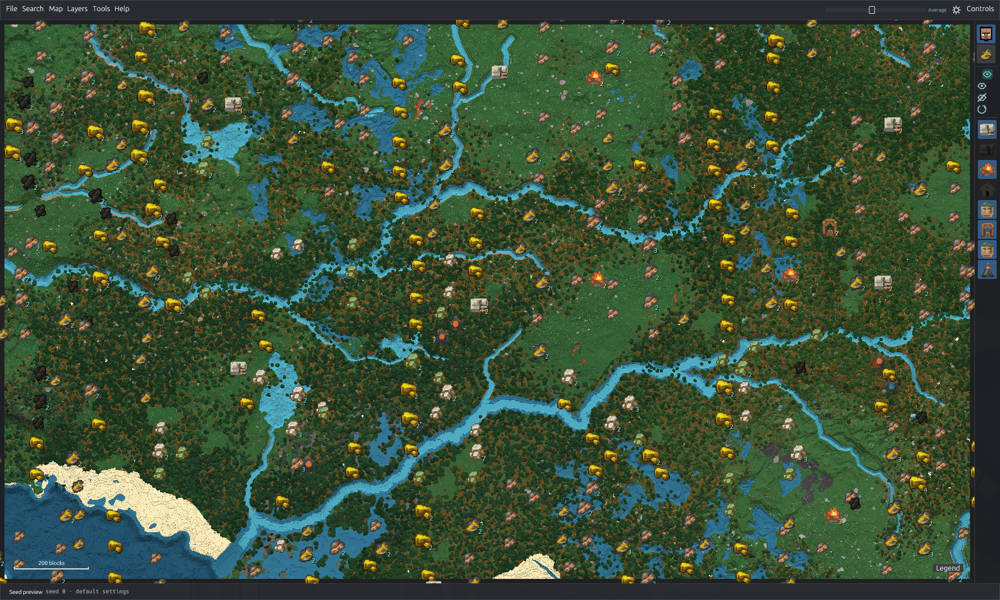

# TerraLens

TerraLens is a native Rust seed atlas for TerraFirmaGreg. Explore biomes, terrain, ores and structures, or inspect a save without launching Minecraft. Saves are read-only.



- Combine biome, climate, height, water, geology, vegetation and surface-detail layers. Choose Fast, Balanced or Full terrain sampling.
- Search structures, ores, volcanoes, biomes and tree habitats with Ctrl+F; inspect structure bounds, previews, chests and vessels.
- Explore the Overworld, 16-block Beneath bands, Moon and Mars. Export maps, markers and waypoints.

Terrain and feature locations are predictions, not a complete Minecraft chunk simulation. See [measured accuracy](docs/GENERATOR-ACCURACY.md), [map layers](docs/MAP-LAYERS.md), [structures and loot](docs/STRUCTURE-PREVIEWS.md) and [performance](docs/PERFORMANCE.md).

## Build

Downloads: [Linux and Windows](https://github.com/xXseesXx/Terralense/releases). The validated pack profile is Minecraft 1.20.1 / Forge 47.4.13, TFG Core 0.9.25, TFC 3.2.25, Beneath 1.0.6 and Ad Astra 1.15.21; other versions need separate validation.

To build from source, install Rust 1.88+ and platform dependencies ([Linux and Windows notes](docs/RELEASING.md)), then:

```sh
git clone https://github.com/xXseesXx/Terralense.git
cd Terralense
./build.sh
./launch.sh
```

Enter a seed or use **File → Open world…** / **Open folder…** to select a save or Prism instance.

## Details

[Validation](docs/NATIVE-VALIDATION.md) · [Terrain accuracy](docs/GENERATOR-ACCURACY.md) · [Vegetation](docs/VEGETATION-GENERATION.md) · [Beneath](docs/BENEATH-GENERATION.md) · [Moon and Mars](docs/PLANETARY-GENERATION.md) · [Release notes](CHANGELOG.md)

Big thanks to **[OutCrop](https://github.com/PauAixala/outcropmap)** by **Pau Aixalà**, the original foundation for TerraLens and its world-generation work.

Source license: [EUPL-1.2](LICENSE). Third-party assets and notices: [NOTICE](NOTICE.md) and [licenses](licenses/). TerraLens is independent of Minecraft, TerraFirmaCraft, TerraFirmaGreg, Cubiomes Viewer and Amidst.
