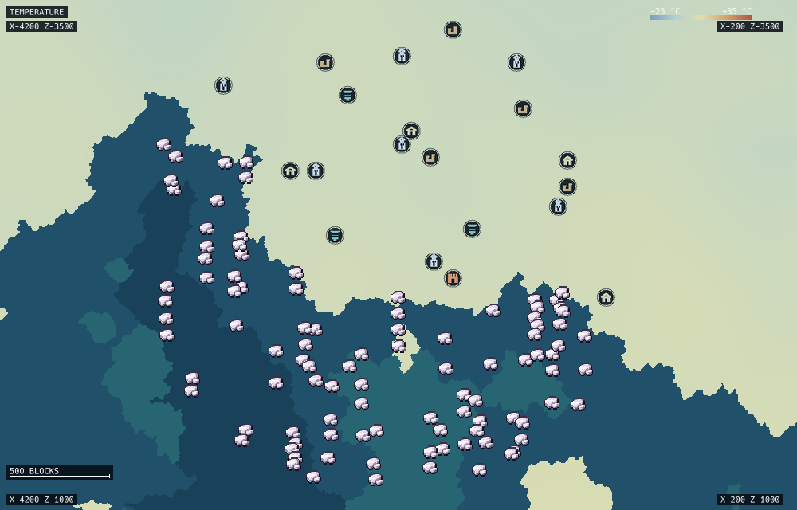

# TerraLens

A native Rust world atlas for **TerraFirmaGreg Modern**, inspired by Cubiomes Viewer and Amidst.
Browse seeds, find a base, prospect for ores, and inspect structures without starting Minecraft.
The interface stays focused on the map, and your saves are opened only for reading.

Validated against Minecraft **1.20.1**, Forge **47.4.13**, TFG Core **0.9.25**, TFC **3.2.25** and
Beneath **1.0.6**. The supported dimensions are **Overworld** and **Beneath / Nether**.



## Features

- Overworld biome, temperature, rainfall, elevation, water/river, geology, forest and hotspot maps.
  Oceans retain their own colors on land-themed maps.
- Beneath biome maps with **16-block vertical bands** and saved-block cave cutaways.
- Unified **Ctrl+F** search for structures, ores and vein contents, biomes, rocks, forests and tree
  habitats. Results are ordered by distance from a configurable point. Enter / Shift+Enter visit
  the next / previous result.
- Interactive raw-ore artwork and original structure icons, recorded structure footprints, pin
  details, and zoom-dependent visibility. Marker groups stay anchored while you pan.
- Close-up block detail from generated chunks, including structures, trees and crops. Missing
  Overworld chunks have a seed vegetation preview; missing Beneath chunks retain biome colors.
  **View blocks** inspects a saved structure inside its bounding box; **Full terrain** exits it.
- Searchable interactive biome/rock legends, palette and highlight controls, connected
  biome/continent hover,
  and configurable clean tooltips with optional tree-species estimates.
- Named seed shortlists, saved spots and collections, sessions, navigation history, coordinate
  jump, grids, a scale bar, a distance ruler, and fit-to-selection.
- Land-area analysis and a sampled site finder combining climate, rock and nearby predicted ore.
  Selected results show the locations supporting their rock and ore conditions.
- Composed PNG maps with marker artwork, footprints, coordinates, scale and a key; raster-only
  PNG, marker CSV, analysis/session JSON and Xaero waypoint sharing.

The Rust window and background engine are separate processes. Generation, save scans, search,
analysis and export run outside the UI; the map displays cached, progressively refined tiles.
No browser, Node, Python service, Java process, or running Minecraft is required.

## Build and run

Linux is the tested platform. Install Rust **1.88 or newer** and the native graphics libraries.
On Debian/Ubuntu, the build dependencies are:

```sh
sudo apt install build-essential pkg-config libwayland-dev libxkbcommon-dev libxkbcommon-x11-dev libx11-dev libxi-dev libxcursor-dev libgl1-mesa-dev
```

```sh
git clone https://github.com/xXseesXx/Terralense.git
cd Terralense
./build.sh
./launch.sh
```

`./install.sh` adds a user-local launcher and a `terralens` command; it needs no root privileges.
Fresh launch opens the seed viewer; there is no automatic Prism scan. Enter a signed 64-bit seed in
the left dock, or open a world from the File menu. A source can also be opened from the command
line:

```sh
terralens --open /path/to/level.dat
terralens /path/to/world-or-prism-folder
```

The optional `TERRALENS_INSTANCE` environment variable opens the specified instance path at launch.

## Opening worlds and using the desktop shell

Use **File → Open world…** to choose a world's `level.dat`. **File → Open folder…** accepts a
world folder, a Minecraft `saves` folder, or a Prism instance folder; TerraLens reads the selected
path. Recent sources are available from **File → Recent worlds**. Saves are read-only.

The resizable left control pane has **Search**, **Biomes**, and **Structures** tabs. Search contains
the **Seeds** shortlist and location finder; Ctrl+F opens **Features** search. The right icon rail
switches between structure and ore types. Its group and individual controls hide or show features,
including related structure variants. This changes display visibility; marker placement remains
spatially anchored as you pan, and zoom progressively hides common or less prominent markers
before rare, important ones. The Structures tab lists visible-area or whole-save structures by
distance and exports the filtered table. Biomes has editable area coordinates and **From visible**.
Toggle the layer legend from **Map → Layer legend**; when hidden, its
map-corner button opens it again.

Import seeds with **File → Import seed list…** (TXT, CSV, or JSON). The named shortlist is included
in saved sessions; an imported seed list is added to the shortlist. **File → Export options…** opens
the map-export window. Map images and visible markers use native save dialogs, so you choose each
output path. **File → Export map image…** exports the current map directly. Session files use
**Ctrl+S** and **Ctrl+O**; **File → Save session as…** selects a new session path.

Marker discovery is spatially cached. Panning and zooming reuse marker positions already found;
progressive zoom filtering changes which markers are drawn. Finer views may scan additional area or
detail for features, while less frequent and more prominent markers remain visible longer. There is
no claim of full Cubiomes multi-seed condition-search parity: the seed list supports comparing
selected seeds, while TFG location analysis remains a sampled search for the active seed.

Normal release builds exclude the diagnostic CLI and the responsiveness recorder. Unknown or
maintenance-only command-line options are rejected before opening a window. `--help` and
`--version` remain available.

## Controls

| Action | Control |
| --- | --- |
| Pan / zoom | Drag / scroll around the pointer |
| Search features | Ctrl+F; Enter / Shift+Enter cycle results |
| Jump to coordinates | Ctrl+G |
| Back / forward | Alt+Left / Alt+Right |
| Save a spot | Ctrl+D |
| Save / load a session | Ctrl+S / Ctrl+O |
| Save session as / open world / export map | Ctrl+Shift+S / Ctrl+Shift+O / Ctrl+E |
| Change Overworld layer | 1–8, outside text fields |
| Change Beneath band | Page Up / Page Down |
| Measure / select and fit an area | Shift-drag / Alt-drag |
| Copy coordinates, waypoint, or search here | Right-click the map |

**Tools → Display and tooltip options…** contains **Block detail rendering** and **Detail at close
zoom**. The first controls close-up block drawing and requests; the second toggles the surface
detail overlay. Search origin, radius, predictions and coverage are in Features' **…** menu.

## Accuracy

Biomes and climate are checked against stored Minecraft observations and separate conversion
fixtures. Elevation is an estimate. Ore pins and outlined/unconfirmed structure pins are
predictions; saved structure starts confirm recorded generation, not whether a structure has been
looted or modified. Tree counts estimate generation attempts, and habitat search is sampled.

Structure bounds and block cutaways require saved structure data. Terrain-dependent placement,
caves, aquifers and unseen structure blocks are not fully generated. Other dimensions, worldgen
v0, and incompatible/custom generation profiles are not supported. Different pack versions need
separate validation.

See [validation](docs/NATIVE-VALIDATION.md), [vegetation](docs/VEGETATION-GENERATION.md),
[Beneath generation](docs/BENEATH-GENERATION.md), and [reference research](docs/QOL-RESEARCH.md).

## Development

```sh
cargo fmt --all --check --manifest-path native/terralens-rs/Cargo.toml
cargo test --release --locked --manifest-path native/terralens-rs/Cargo.toml
cargo check --release --locked --no-default-features --lib --manifest-path native/terralens-rs/Cargo.toml
```

Maintainer diagnostics require an explicit opt-in build:

```sh
cargo build --release --locked --features diagnostics --manifest-path native/terralens-rs/Cargo.toml
native/terralens-rs/target/release/terralens --info
```

Use `./build.sh` again to restore the normal release. Developer examples also require
`--features diagnostics`. Tests and their immutable fixtures stay in source control; they do not
run during normal application startup. All required generation tables are vendored in the Rust
crate; the retired prototypes and local upstream checkout are not part of the build.

## License and attribution

TerraLens is **EUPL-1.2**. Its native generator derives from
[OutCrop](https://github.com/PauAixala/outcropmap) by Pau Aixalà and the pinned TFC/TFG algorithms.
See [LICENSE](LICENSE), [NOTICE](NOTICE.md), and the retained
[upstream attribution](licenses/OUTCROP-NOTICE.md). Bundled ore art and fonts retain their upstream
licenses; the structure icons are original code-drawn artwork. TerraLens is an independent tool,
not an official Minecraft, TerraFirmaCraft, TerraFirmaGreg, Cubiomes or Amidst project.
